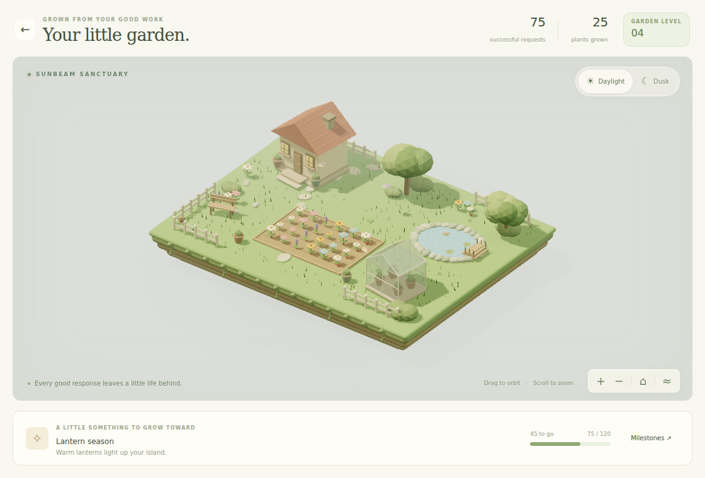
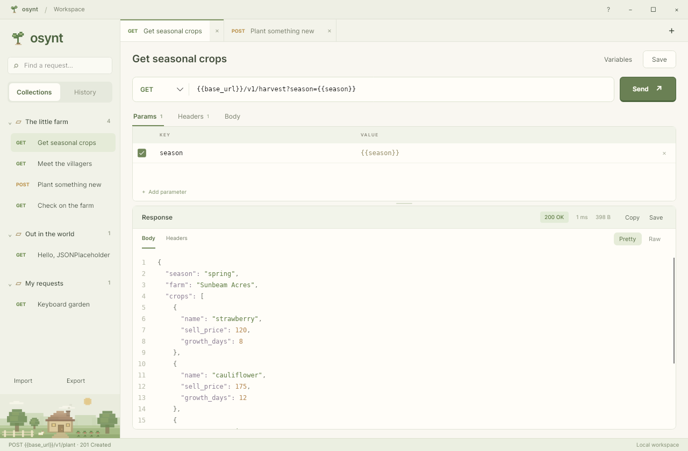

# Osynt 🌱

A cozy desktop API client. Send requests, save collections, and grow a 3D garden with every successful response. No account needed.





## Run

Building requires the [.NET 10 SDK](https://dotnet.microsoft.com/download/dotnet/10.0).

From WSL, build and launch the Windows app:

```sh
bash scripts/publish-windows.sh
bash scripts/run-windows.sh
```

Or run the desktop app directly:

```sh
dotnet run --project src/Osynt.Desktop
```

The interactive 3D garden runs on Windows with WebView2.

## Try it

- Paste an API URL and press **Send**, or open a sample from **The little farm**.
- Click **Your garden** or press **Ctrl+G**. Successful requests grow plants and unlock new features.
- Try **Dusk**, drag to orbit, and scroll to zoom. Your progress saves locally.

Built with Avalonia, .NET, Three.js, and Tailwind CSS.

## Development

See [the architecture guide](docs/architecture.md) for layer boundaries, feature ownership,
and persistence behavior. Run the integration and headless desktop checks with:

```sh
dotnet run --project tests/Osynt.Checks
```
